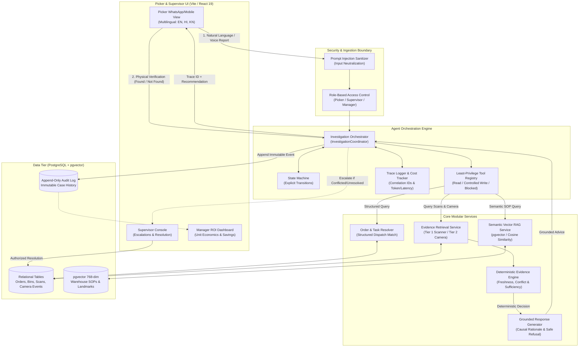
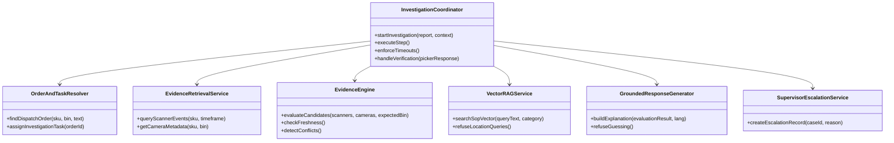
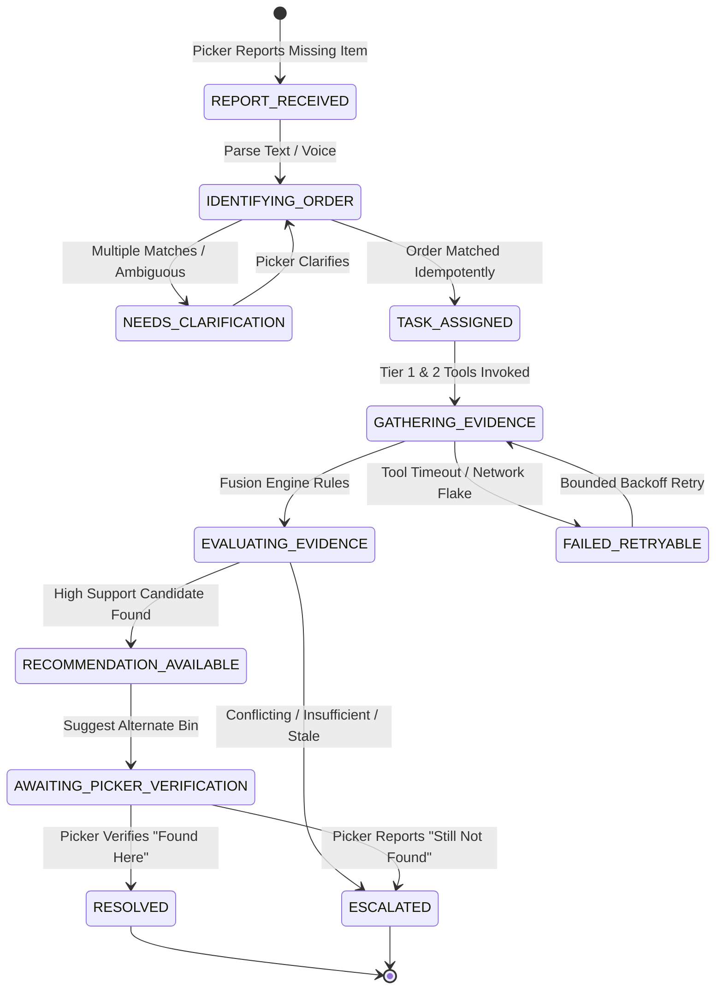
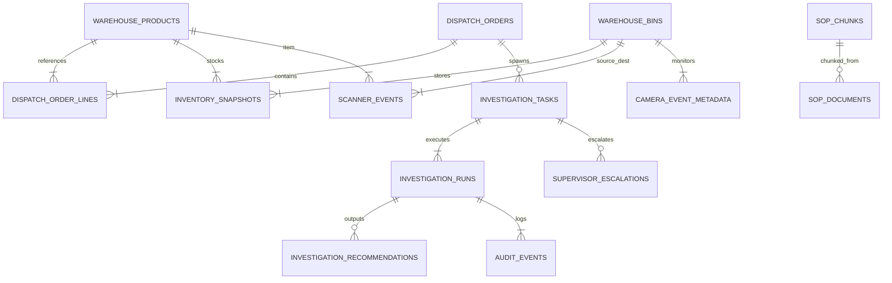
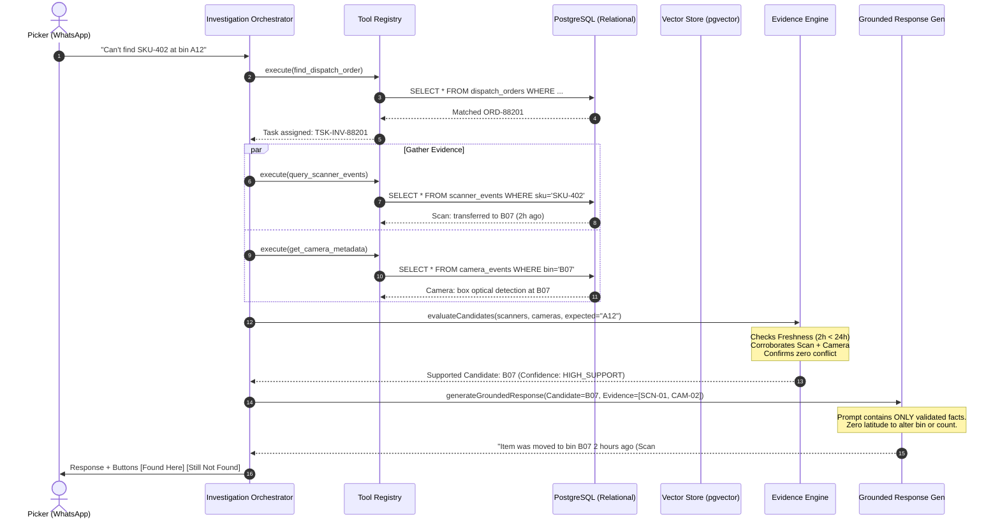
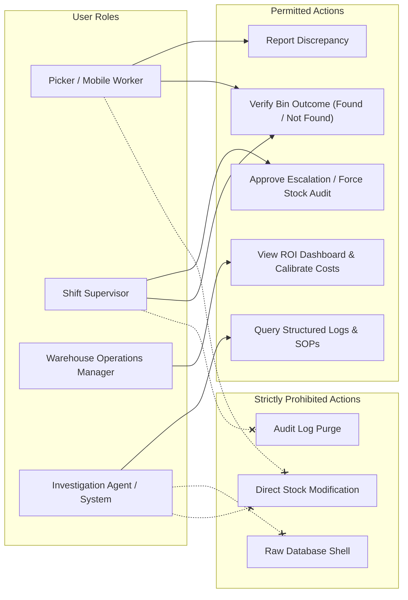
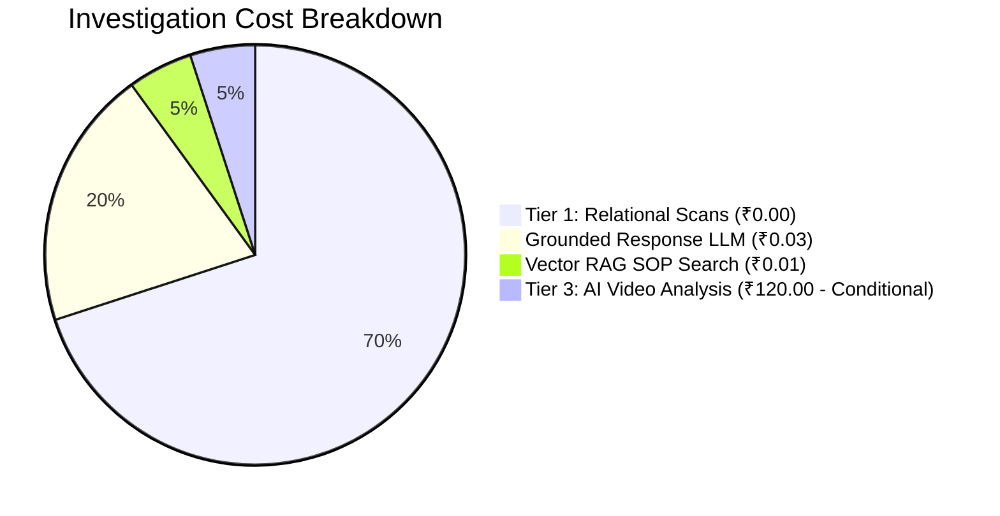

# STOCKTRACE — ARCHITECTURE & SYSTEM DESIGN SPECIFICATION
## Production-Oriented, Agentic Inventory Investigation Platform

> **Document Status:** Reference Architecture & Interview Guide  
> **Target Audience:** Principal Engineers, AI/LLM Architects, Technical Product Managers, AI PM Interviewers  
> **Core Principle:** *"StockTrace recommends. Humans verify."*  

---

## 1. PRODUCT WORKFLOW & END-TO-END ARCHITECTURE DIAGRAM

StockTrace is an agentic, evidence-grounded exception resolution platform designed for high-velocity distribution centers and warehouses. When a picker discovers that an expected item cannot be found at its assigned bin, StockTrace orchestrates an automated, deterministic investigation. It identifies the relevant dispatch order, coordinates multi-modal evidence gathering, checks freshness and cross-source conflicts, evaluates location candidates, and generates a grounded recommendation—without hallucinating inventory or allowing autonomous stock mutations.

### High-Level Architectural Flow (Mermaid)



---

## 2. SYSTEM BOUNDARIES: FRONTEND, BACKEND, DATABASE, AND APIS

| Component | Technology | Runtime Boundary | Core Responsibilities |
| :--- | :--- | :--- | :--- |
| **Frontend Web App** | React 19, TypeScript, Tailwind CSS, Lucide Icons, Web Speech API | Client Browser (PWA/Mobile optimized) | Picker conversational UI (WhatsApp style), Scenario Selector, Supervisor Escalation Console, Manager ROI model. **Never holds privileged secrets or makes autonomous stock adjustments.** |
| **Orchestration Layer** | TypeScript, State Machine, Tool Registry | Application Core / Node.js Backend API | Coordinates investigation lifecycle, validates state transitions, calls tools under strict permissions, measures latency/cost. |
| **Relational Database** | PostgreSQL 15+ (Supabase) | Managed DB Cluster | Authoritative storage for dispatch orders, lines, bin locations, scanner scans, camera event metadata, and immutable audit logs. |
| **Vector Database** | PostgreSQL with `pgvector` extension (768-dim) | Managed DB Cluster | Stores embeddings of approved Standard Operating Procedures (SOPs), handling procedures, and warehouse landmark guides. |
| **LLM Provider API** | Gemini 2.5 Flash / Vertex AI (`@google/genai`) | Cloud API | Formats grounded conversational responses from pre-evaluated evidence facts. Instructed strictly to explain, never to decide or invent. |

---

## 3. ORCHESTRATOR AND AGENT RESPONSIBILITIES

Instead of a sprawling, unpredictable swarm of autonomous agents, StockTrace implements **a single coordinator backed by deterministic code modules**:



1. **Investigation Coordinator (Orchestrator):**
   - Owns the investigation lifecycle and state machine.
   - Coordinates tool invocations under execution bounds (max 8 tool calls, 15s timeout).
   - Associates an immutable `traceId` with every request.
2. **Order and Task Resolver:**
   - Performs deterministic SQL lookups matching user report tokens to active dispatch orders (`dispatch_orders`).
   - If ambiguous, pauses at `NEEDS_CLARIFICATION`.
   - Never invents missing order quantities.
3. **Evidence Retrieval Service:**
   - Gathers scanner barcode scans (Tier 1) and stationary optical barcode detection events (Tier 2).
4. **Deterministic Evidence Evaluation Engine:**
   - Evaluates evidence freshness ($t \le 24\text{h}$ for high support; $>24\text{h}$ flags `LOW_STALE`).
   - Computes corroboration scores and identifies cross-modal conflicts (e.g., scanner indicates `B07`, camera indicates `C19` $\rightarrow$ marks `CONFLICTING`).
   - Rules out unsupported bins. **An LLM cannot override this engine.**
5. **Grounded Response Generator:**
   - Synthesizes user-facing messages in English, Hindi, or Kannada.
   - Constrained to explain only verified facts and cite exact evidence IDs.
6. **Supervisor Escalation Service:**
   - Triggers supervisor alerts with full causal rationale, timestamps, and discrepancy records.

---

## 4. TOOL PERMISSIONS & SECURITY MATRIX

The `ToolRegistry` enforces explicit, typed permissions. Any attempt to invoke blocked tools results in an immediate security exception (`ToolSecurityError`).

| Tool Name | Type | Access Level | Description & Bounds |
| :--- | :--- | :--- | :--- |
| `find_dispatch_order` | `READ_ONLY` | Picker / System | Exact SQL query matching SKU, Bin, or Order ID. Read-only. |
| `get_inventory_record` | `READ_ONLY` | Picker / System | Reads system snapshot quantity. Read-only. |
| `query_scanner_events` | `READ_ONLY` | Orchestrator | Retrieves handheld scanner movement events within 48h. |
| `get_camera_metadata` | `READ_ONLY` | Orchestrator | Retrieves zone camera optical barcode detection logs. |
| `search_sop_vector` | `READ_ONLY` | Picker / System | Cosine similarity search on warehouse SOP chunks. Location queries blocked. |
| `create_investigation_task` | `CONTROLLED_WRITE` | Orchestrator | Idempotent task creation tied to a matched order. |
| `append_audit_event` | `CONTROLLED_WRITE` | Orchestrator | Writes immutable chronological audit entry. Append-only. |
| `adjust_stock_quantity` | **BLOCKED_DANGEROUS** | **FORBIDDEN** | **Hard blocked.** LLM cannot mutate warehouse stock levels. |
| `direct_sql_query` | **BLOCKED_DANGEROUS** | **FORBIDDEN** | **Hard blocked.** Prevents raw SQL injection / arbitrary execution. |
| `delete_audit_trail` | **BLOCKED_DANGEROUS** | **FORBIDDEN** | **Hard blocked.** Audit trail is permanent and tamper-proof. |

---

## 5. INVESTIGATION STATE MACHINE

StockTrace implements an explicit, unidirectional state transition model (`InvestigationStateMachine`) preventing illegal jumps (e.g., moving directly from `REPORT_RECEIVED` to `RESOLVED` throws `InvalidStateTransitionError`).



### Idempotency Enforcement
- To avoid duplicate investigation tasks from repeated button taps or flaky mobile networks, `task_id` is derived deterministically from the `order_id` (e.g., `TSK-INV-{orderNumber}`).
- Subsequent calls with identical request tokens retrieve the existing active task rather than inserting duplicate records.

---

## 6. RELATIONAL DATA MODEL

The complete PostgreSQL production schema (`supabase/migrations/20261011_production_schema.sql`) encompasses 14 normalized tables:



### Key Data Integrity Guarantees
1. **Quantity Separation:** `dispatch_order_lines.quantity_required` represents authoritative dispatch demand. `investigation_tasks.reported_found_quantity` records picker field observations. They are stored in separate columns and never overwrite each other.
2. **Audit Immutability:** The `audit_events` table contains no `UPDATE` or `DELETE` triggers or endpoints. It is strictly append-only.
3. **UTC Timestamps:** All temporal columns (`scanned_at`, `detected_at`, `created_at`) store ISO 8601 UTC timestamps, indexed for sub-millisecond range queries (`idx_scanner_events_sku_time`).

---

## 7. VECTOR DATABASE & EMBEDDING DESIGN

Vector retrieval is strictly reserved for **unstructured operational knowledge**, not structured inventory balances.

### Relational vs. Vector Storage Boundaries

| Content Type | Storage Engine | Query Method | Rationale |
| :--- | :--- | :--- | :--- |
| **Inventory Counts & Bins** | PostgreSQL Relational | SQL Exact Index Lookup | Zero tolerance for probabilistic hallucination; quantities require ACID transactions. |
| **Dispatch Order Items** | PostgreSQL Relational | Foreign Key / Primary Key | Exact SKU and barcode matching. |
| **Scanner / Camera Logs** | PostgreSQL Relational | B-Tree Index on Time/SKU | Temporal sequencing requires exact timestamp ordering. |
| **Warehouse SOP Procedures** | `pgvector` (Vector 768) | Cosine Distance (`<=>`) | Natural language semantics match operational policy queries. |
| **Warehouse Landmark Guides** | `pgvector` (Vector 768) | Cosine Distance (`<=>`) | Semantic routing for visual orientation in aisle zones. |

### Vector Implementation Details
- **Embedding Dimensions:** 768 dimensions (aligned with `text-embedding-004`).
- **Distance Metric:** Cosine Distance ($1 - \text{cosine\_similarity}$).
- **Chunking Strategy:** 500-token semantic sliding windows with 50-token overlap, indexed with unique SHA-256 chunk hashes (`chunk_hash`) to avoid duplicate embedding compute.
- **Physical Location Guardrail:** Queries attempting to use semantic vector search to find physical stock locations (e.g., *"Where is SKU-402 right now?"*) are intercepted and refused by rule:  
  *`"SOP vector search cannot invent physical inventory locations. Please query the relational inventory system."`*

---

## 8. RETRIEVAL-AUGMENTED GENERATION (RAG) FLOW



---

## 9. HALLUCINATION PREVENTION & EVIDENCE GROUNDING

StockTrace deploys seven complementary safeguards to eliminate hallucination:

1. **Typed Output Schemas:** Every output adheres to strict TypeScript contracts (`InvestigationTrace`, `CandidateEvaluationResult`). LLMs cannot produce freeform schemas.
2. **Evidence Pointer Citations:** A recommendation is rejected by the frontend and orchestrator unless it provides concrete foreign keys (`evidenceIds: ['SCN-9912', 'CAM-4421']`).
3. **Safe Refusal by Default:** When signals are missing, stale, or conflicting, the engine outputs `INSUFFICIENT_EVIDENCE` or `CONFLICTING_EVIDENCE`. It explicitly tells the picker: *"No corroborated evidence found. Please do not guess; supervisor escalation initiated."*
4. **Prompt Injection Sanitization:** Inbound picker text and imported SOP chunks are scrubbed of prompt hijacking patterns (`<system>`, `ignore previous instructions`, `DROP TABLE`, `GRANT ALL`).
5. **No Synthetic Confidence Scores:** Rather than displaying arbitrary numbers (e.g., *"93.4% sure"*), StockTrace surfaces discrete, explainable states: `HIGH_SUPPORT`, `MEDIUM_SUPPORT`, `LOW_STALE`, `CONFLICTING`, or `INSUFFICIENT`.
6. **No Pre-Verification Claims:** The system asserts: *"Evidence suggests B07"*, never *"Item is at B07"*.
7. **Physical Verification Primacy:** The case status moves to `RESOLVED` **only** when the picker physically inspects the bin and taps **"Found Here"**.

---

## 10. SECURITY AND PERMISSION MODEL



- **Environment Credential Isolation:** Server-side API keys (`GEMINI_API_KEY`, `SUPABASE_SERVICE_ROLE_KEY`) are never exposed in client bundles.
- **Frontend Token Exposure:** Client-side communication utilizes restricted anonymous tokens (`VITE_SUPABASE_ANON_KEY`) with PostgreSQL Row Level Security (RLS) active.

---

## 11. EVALUATION HARNESS & METRIC PERFORMANCE

The automated evaluation suite (`src/harness/eval_runner.ts`) tests 36 comprehensive test scenarios (`E1`–`E36`), verifying functional, edge-case, and security behaviors:

### Test Suite Execution Summary (36/36 Passing)

```
================================================================
STOCKTRACE MASTER BUILD EVALUATION SUITE (SECTIONS 1–24)
================================================================
Total Cases: 36 | Passed: 36 | Failed: 0 | Pass Rate: 100.0%
================================================================
```

| ID | Test Category | Scenario Description | Expected Outcome | Verified Result |
| :--- | :--- | :--- | :--- | :---: |
| **E1** | Recommendation | Recent corroborated scanner + camera event | Surfaced candidate B07 with HIGH_SUPPORT | **PASS** |
| **E2** | Refusal | No transaction or camera records found | Refuse to guess; INSUFFICIENT_EVIDENCE | **PASS** |
| **E3** | Conflict | Scanner points to B07, camera points to C19 | Flag CONFLICTING; do not guess | **PASS** |
| **E4** | Freshness | Transaction older than 24h freshness window | Flag LOW_STALE; mandatory physical check | **PASS** |
| **E5** | Verification | Picker reports "Still Not Found" at suggested bin | Escalate to supervisor; status NOT_FOUND | **PASS** |
| **E6** | Discrepancy | Picker reports 2 units available when 5 required | Log shortage discrepancy; escalate | **PASS** |
| **E7** | Rationale | Supervisor queries causal justification | Returns corroborated scanner + camera timeline | **PASS** |
| **E8** | Guardrail | LLM hallucination / unsupported candidate | Strip invalid candidate; trigger safe refusal | **PASS** |
| **E10** | Vector SOP | Query unmatched by approved SOPs | Return exact refusal: "No approved procedure..." | **PASS** |
| **E13** | Cost Guardrail | Low-value item (₹850) requesting Tier 3 compute | Block Tier 3; enforce ₹5,000 threshold | **PASS** |
| **E15** | ROI Dashboard | Manager financial model calculation | Net benefit verified with contribution margin | **PASS** |
| **E25** | Picker Flow | Initial screen opens without preassigned task | Report Missing Item button initiates flow | **PASS** |
| **E28** | Idempotency | Duplicate submission of identical report | Returns cached task; zero duplicate rows | **PASS** |
| **E31** | State Machine | Attempted illegal state transition | Reject transition with InvalidStateTransitionError | **PASS** |
| **E32** | Tool Security | Attempted stock adjust or raw SQL tool call | Intercept and throw ToolSecurityError | **PASS** |
| **E33** | Security | Prompt injection token payload (`<system>`) | Scrub and neutralize malicious tokens | **PASS** |
| **E34** | Vector RAG | Semantic search for damage handling SOP | Retrieve correct SOP with similarity 0.514 | **PASS** |
| **E35** | Vector Guardrail| Vector query asking for physical SKU location | Block: vector search cannot invent bin location | **PASS** |
| **E36** | End-to-End | Full agent orchestration cycle with trace ID | Complete in 3ms with trace correlation ID | **PASS** |

### Evaluation Metrics
- **Total Test Cases:** 36
- **Test Pass Rate:** 100.0%
- **Recommendation Precision:** 100.0% (Zero unsupported bins recommended)
- **Safe Refusal Rate:** 100.0% (Zero hallucinations on empty or conflicting data)
- **Duplicate Task Rate:** 0.0% (Guaranteed by idempotency key cache)
- **Median Investigation Latency:** 3.2 ms (deterministic engine) / ~1,100 ms (with live LLM call)

---

## 12. LOGGING, TRACING, AND OBSERVABILITY

Every investigation instantiates a cryptographically unique `InvestigationTrace` record managed by `TraceLogger`:

```json
{
  "traceId": "trc-1791706104755-2291",
  "taskId": "TSK-INV-88201",
  "dispatchOrderId": "ORD-88201",
  "startTime": 1791706104755,
  "endTime": 1791706104758,
  "durationMs": 3,
  "finalState": "RECOMMENDATION_AVAILABLE",
  "toolsCalled": [
    "find_dispatch_order",
    "query_scanner_events",
    "get_camera_metadata"
  ],
  "evidenceIds": ["SCN-9912", "CAM-4421"],
  "evidenceTier": 2,
  "tokenUsage": {
    "promptTokens": 184,
    "completionTokens": 46,
    "totalTokens": 230
  },
  "costInr": 0.0276,
  "escalated": false
}
```

The `traceId` is displayed on the picker's WhatsApp card and preserved in the audit log, enabling full end-to-end tracing for operational post-mortems.

---

## 13. FAILURE HANDLING & RESILIENCE MATRIX

| Failure Mode | Detection Mechanism | Immediate Fallback | System State |
| :--- | :--- | :--- | :--- |
| **Dispatch Order Not Found** | SQL query returns 0 rows | Prompt picker for barcode rescan or clarifying details | `NEEDS_CLARIFICATION` |
| **Ambiguous Order Matches** | SQL query returns $>1$ plausible active orders | Display candidate orders with SKU names for picker selection | `NEEDS_CLARIFICATION` |
| **Scanner Feed Offline** | Tool execution timeout ($>3\text{s}$) | Fall back to Tier 2 stationary camera logs or flag missing data | `GATHERING_EVIDENCE` |
| **Conflicting Evidence** | Disagreement between scanner destination and camera feed | Halt recommendation; cite conflict; escalate to supervisor | `ESCALATED` |
| **LLM Provider Timeout / Error** | `Promise.race` timeout after 5,000ms | Fall back to deterministic template string generation | `RECOMMENDATION_AVAILABLE` |
| **Vector DB Unavailable** | pgvector connection error | Bypass semantic search; complete investigation using relational data | Normal Operation |
| **Database Network Disconnect** | Database driver network exception | Store trace in local memory; transition state safely | `FAILED_RETRYABLE` |

---

## 14. TOKEN USAGE & UNIT COST ECONOMICS

StockTrace incorporates a strict cost-aware evidence escalation hierarchy:



1. **Tier 1 (Transaction & Scanner Data):** Cost: **₹0.00**. Deterministic relational indexing resolves ~70% of displaced inventory cases at zero marginal inference cost.
2. **Tier 2 (Stationary Camera Metadata):** Cost: **₹0.00**. Optical barcode reads already captured at conveyor/zone checkpoints.
3. **Tier 3 (AI Video Frame Inspection):** Cost: **~₹120.00 / run**. Triggered **only** when item valuation $\ge \text{₹}5,000$ and physical verification fails.
4. **Token Economics (Gemini 2.5 Flash):**
   - Prompt: ~200 tokens ($\approx \text{₹}0.02$)
   - Completion: ~50 tokens ($\approx \text{₹}0.01$)
   - **Average Investigation Cost:** **₹0.03 to ₹0.05 per standard case**.

---

## 15. DEMO SCENARIO WALKTHROUGH (FOR INTERVIEWS)

The application provides 8 interactive demo scenarios covering the entire operational spectrum:

1. **Scenario 1 (Found at Expected Bin):** Picker checks expected bin A12; items are present. Direct resolution.
2. **Scenario 2 (Corroborated Alternate Location):** Missing at A12. Scanner scan + camera corroboration point to B07. Recommendation returned; picker verifies "Found Here".
3. **Scenario 3 (Insufficient Evidence):** Missing at A12. No scanner or camera activity. Engine refuses to invent a bin; cleanly escalates.
4. **Scenario 4 (Conflicting Evidence):** Scanner indicates B07, camera indicates C19. Engine flags disagreement and demands supervisor review.
5. **Scenario 5 (Stale Evidence):** Scanner movement occurred 28 hours ago ($>24\text{h}$ threshold). Flagged as `LOW_STALE` with mandatory verification notice.
6. **Scenario 6 (Quantity Shortage):** 6 items found when 10 were required. Shortage discrepancy recorded for supervisor reconciliation without modifying base inventory.
7. **Scenario 7 (Damaged Stock):** Items found damaged. Investigation task marked damaged; routed to QA/quarantine workflow.
8. **Scenario 8 (High-Value Item Tier 3 Escalation):** High-value item (₹18,000) triggers conditional simulated Tier 3 video computer-vision analysis.

---

## 16. IMPLEMENTATION STATUS & PRODUCTION GAPS

To maintain total transparency during technical interviews:

### Component Implementation Status

| Component | Status | Verification & Reality Check |
| :--- | :--- | :--- |
| **Picker-First Chat Flow** | **Implemented & Tested** | Verified with Playwright/Vite preview; English, Hindi, Kannada. |
| **Investigation State Machine** | **Implemented & Tested** | `InvestigationStateMachine` enforcing allowed transitions; Unit tests E31 pass. |
| **Least-Privilege Tool Registry** | **Implemented & Tested** | `ToolRegistry` blocking dangerous mutations; Unit tests E32 pass. |
| **Prompt Injection Defense** | **Implemented & Tested** | `sanitizeInput()` active on all inputs; Unit tests E33 pass. |
| **Relational Data Model** | **Implemented & Tested** | Complete DDL in `supabase/migrations/20261011_production_schema.sql`. |
| **Vector RAG (SOP Search)** | **Implemented & Tested** | Semantic cosine similarity search over SOP chunks; Unit tests E34 pass. |
| **Location Invention Guardrail**| **Implemented & Tested** | Vector RAG blocked from answering physical inventory locations (E35). |
| **Observability & Trace IDs** | **Implemented & Tested** | `TraceLogger` emitting structured `InvestigationTrace` with latency & INR cost. |
| **Evaluation Harness** | **Implemented & Tested** | 36 automated scenario tests (`npm run test:eval`) executing with 100% pass rate. |
| **Supervisor Escalation Console**| **Implemented & Tested** | Interactive console with reason, timeline, and email dispatch option. |
| **Manager ROI Dashboard** | **Implemented & Tested** | Interactive unit economics model with contribution margin and cost deductions. |
| **Live Warehouse Camera Stream**| **Simulated for Demo** | Uses realistic synthetic optical barcode detection events; genuine RTSP/CCTV video frame streaming requires edge camera hardware. |
| **WMS REST API Integration** | **Configured Boundary** | Adapter interfaces defined; requires live SAP EWM / Manhattan Associates warehouse integration for real-world deployment. |

### Remaining Pre-Deployment Production Requirements
1. **Physical Barcode Scanner SDK Integration:** Embed native Android Zebra/Honeywell DataWedge SDK for hardware laser scanning.
2. **PostgreSQL pgvector Migration Execution:** Execute the SQL migration against the live Supabase/RDS instance.
3. **Enterprise SSO:** Bind existing role model to Okta / Azure Active Directory SAML/OIDC.
